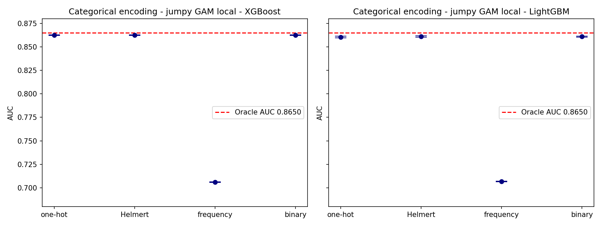
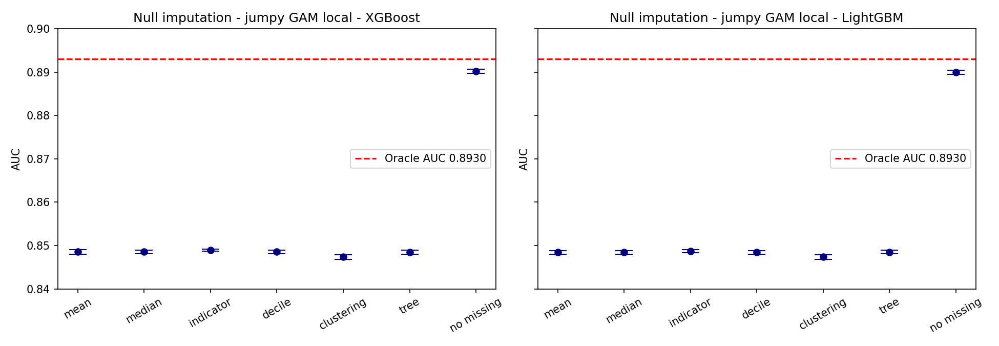

# Jumpy GAM Local: Replication of Preprocessing Experiments

A machine learning replication project investigating how **categorical encoding** and **missing-value imputation** affect binary classification performance, using the *Jumpy GAM Local* synthetic dataset.

The project reproduces selected experiments from the paper **"A Comparison of Modeling Preprocessing Techniques"** (Johnson, Liu, Raza and McGuire, 2nd Order Solutions, 2023, [arXiv:2302.12042](https://arxiv.org/abs/2302.12042)) using **XGBoost**, and extends them with **LightGBM** as an additional experiment assigned by our mentor, Dr. Sujata Kolhe.

> **Note:** LightGBM is our additional extension. It is not part of the original paper's experiments (the paper lists other algorithms as future work).

**Author:** [@anuradhawagh](https://github.com/anuradhawagh)  
**Mentor:** Dr. Sujata Kolhe

---

## 1. Project Overview

| Component | Model | Description |
|---|---|---|
| Paper replication | XGBoost | Reproduces the categorical encoding (Fig. 10, Table 3) and null imputation (Fig. 15) experiments |
| Additional extension | LightGBM | Runs the same experiments with a second gradient-boosting algorithm to see if the patterns hold |

Not replicated: feature selection experiments (Observations 1–5) and the Lending Club real-world dataset.

## 2. Objectives

- Generate the Jumpy GAM Local synthetic dataset from the paper's equations.
- Compare four categorical encoding techniques.
- Compare six missing-value imputation techniques.
- Evaluate models with ROC-AUC, using the oracle AUC as the upper benchmark.
- Compare the XGBoost replication with the LightGBM extension.

## 3. Technical Concepts

**Synthetic dataset.** Data generated by code instead of collected from the real world, so the true relationship between features and target is known. Here: numeric features drawn from a multivariate normal distribution (neighbouring pairs correlated at r = 0.5), 5 pure-noise features, one categorical column, and a binary target.

**Generalized Additive Model (GAM).** A model where the output is a sum of separate functions of individual features. The *jumpy GAM local* version adds indicator functions I(·) so that some terms only switch on in parts of the feature space (local interactions). The target is generated as: logit f(x) → sigmoid → Bernoulli draw.

**Oracle AUC.** The best AUC any model could reach if it knew the true underlying probabilities. It is the upper-bound benchmark on synthetic data.

**ROC curve and AUC.** The ROC curve plots True Positive Rate against False Positive Rate over all classification thresholds. **AUC** (Area Under the ROC Curve) summarizes how well a model ranks positives above negatives: 1.0 is perfect ranking, 0.5 is random. It does not depend on a single threshold.

**Categorical encoding.** Converting categories to numbers a model can use:
- **One-hot encoding (OHE):** one binary column per category (3 columns here).
- **Helmert (reverse) coding:** contrast values comparing each level with the previous levels (2 columns here).
- **Frequency encoding:** replaces each category with its share of the training rows (1 column).
- **Binary encoding:** writes the category number as binary digits across columns (2 columns).

**Missing-value imputation.** Handling missing values so a model can use the data:
- **Mean / median imputation:** fill with the column mean or median.
- **Missing-indicator imputation:** fill with a placeholder (-9999) and add a 0/1 column flagging missing values, so the model learns from the missingness itself.
- **Decile imputation:** group the feature into 10 deciles plus a "missing" group, and fill with the median of the decile whose target rate is closest to the missing group's.
- **Clustering imputation:** k-means clusters, then fill with the cluster's mean.
- **Decision-tree imputation:** a single-feature tree plus a t-test choose which leaf's median to use.

**Gradient boosting.** An ensemble method that builds decision trees one after another, each correcting the errors of the previous ones. **XGBoost** is used for the replication; **LightGBM** is used for the extension.

**Hyperparameter optimization.** Tuning settings that control training. We use **Bayesian optimization with Optuna** (TPE sampler, 20 trials per model) over the number of trees, learning rate, max depth and gamma (`min_split_gain` for LightGBM).

**Mean ± 2 SD.** Each experiment is repeated on 30 training sets. Plots show the mean AUC with error bars of ±2 standard deviations, as in the paper.

## 4. Methodology

1. **Data generation.** About 250K rows per dataset.
   - *Encoding:* 10 numeric + 5 noise features and a 3-category column (Table 7, Eq. 8), 249,999 rows.
   - *Imputation:* 10 numeric + 5 noise features and a 5-category column (Table 6, Eq. 3), 250,000 rows, with 50% missing values injected into `x1`, `x4`, `x6`.
2. **Coefficients.** Chosen by a seed search so classes are roughly balanced (seed 1 for encoding, seed 46 for imputation).
3. **Datasets (as in the paper).** 30 training sets (seeds 1000–1029), 3 validation sets (seeds 2000–2002), 3 tuning sets (seeds 3000–3002).
4. **Preprocessing.** Apply the encoding or imputation method under test. All statistics (means, frequencies, cluster centres) come from the training data only, so no information leaks from validation data.
5. **Training and tuning.** Tune each model on the tuning sets (sets 1 and 2 to train, set 3 to validate; this split is our own choice), then fix the best settings.
6. **Evaluation.** Validation AUC averaged over the 3 validation sets, repeated for each of the 30 training sets.
7. **Aggregation.** Results are saved to CSV and plotted with oracle AUC as a red dashed line.

## 5. Results

### Experiment 1: Categorical encoding (oracle AUC = 0.865)

| Encoding | XGBoost AUC | LightGBM AUC |
|---|---|---|
| One-hot | 0.8625 | 0.8605 |
| Helmert (reverse) | 0.8625 | 0.8612 |
| Binary | 0.8625 | 0.8610 |
| Frequency | **0.7059** | **0.7068** |



- **Observation 6 reproduced.** One-hot, Helmert and binary encoding reach nearly the oracle AUC, but frequency encoding falls by about 0.15 AUC. The three categories are equal in size (frequency 0.3333 for each), so a single frequency column cannot tell them apart.
- **Observation 7 reproduced for XGBoost.** One-hot and Helmert produce identical predictions (maximum difference 0 on all three validation sets). Split counts match for all 15 ordinary features, and both use 3004 splits in total on the encoded columns (the analogue of the paper's Table 3).
- **LightGBM extension.** The two encodings are close but not identical (maximum prediction difference about 0.08, different split counts), so the identical-predictions result held for XGBoost but not for LightGBM.

### Experiment 2: Null imputation (oracle AUC ≈ 0.893; no-missing reference ≈ 0.890)

| Method | XGBoost AUC | LightGBM AUC |
|---|---|---|
| Missing indicator | **0.8490** | **0.8487** |
| Decile | 0.8486 | 0.8484 |
| Mean | 0.8485 | 0.8484 |
| Median | 0.8485 | 0.8484 |
| Decision tree | 0.8485 | 0.8485 |
| Clustering | 0.8474 | 0.8474 |
| No missing (reference) | 0.8902 | 0.8899 |



- **Observation 8 reproduced (weakly).** Missing-indicator imputation has the highest AUC for both models, but its lead over the other methods is only about 0.0004–0.0005 AUC.
- **Observation 9 reproduced.** Mean, median and decile imputation perform almost identically.
- **Observation 10 not reproduced.** The paper reports decision-tree imputation as highly variable. In our runs it was as stable as the other methods (standard deviation about 0.0002 over 30 training sets).
- Every imputation method stays about 0.04 AUC below the no-missing reference, so injecting 50% missing values costs far more than the choice of imputation method.

### Experiment 3: LightGBM vs XGBoost

LightGBM follows the same ranking of methods as XGBoost in both experiments, with slightly lower AUC in most cases. Frequency encoding is clearly worst for both models, and missing-indicator imputation is best for both.

## 6. Repository Structure

```
jumpy-gam-local-preprocessing/
├── README.md
├── .gitignore
├── ml_final_replication(1).ipynb   # data generation, tuning, experiments, plots
├── encoding_results.csv            # AUC per model, encoding and training set
├── imputation_results.csv          # AUC per model, imputation method and training set
├── fig10_replication.png           # replication of paper Figure 10
└── fig15_replication.png           # replication of paper Figure 15
```

## 7. Technologies and Libraries

Python 3, Jupyter Notebook, NumPy, pandas, SciPy, scikit-learn (metrics, k-means, decision tree), XGBoost, LightGBM, Matplotlib, Optuna.

```bash
pip install numpy pandas scipy scikit-learn xgboost lightgbm matplotlib optuna
```

## 8. How to Run

```bash
git clone https://github.com/anuradhawagh/jumpy-gam-local-preprocessing.git
cd jumpy-gam-local-preprocessing
```

1. Open `ml_final_replication(1).ipynb` in Google Colab, JupyterLab or VS Code.
2. Install the libraries above.
3. Run all cells in order.

**Runtime:** about 2.3 minutes per training set for encoding (about 1.2 hours for all 30) and about 2.1 minutes per training set for imputation (about 1 hour for all 30). Both experiment cells save results to CSV after each training set and skip finished sets on re-run, so an interrupted run can be resumed.

## 9. Differences from the Paper

- The paper reports XGBoost only; LightGBM is our mentor-assigned extension.
- Coefficients come from a seed search for balanced classes, so oracle AUCs differ from the paper's (encoding: 0.865 here vs. 0.8575 in Fig. 10; imputation: about 0.893 here vs. 0.9484 in Fig. 15).
- Tuning uses Optuna (TPE, 20 trials), and the tuning split is our own choice since the paper does not specify one.
- Only the categorical encoding and null imputation experiments on the jumpy GAM local data are replicated.

## 10. Limitations

- Results come from synthetic data and may not generalize to real-world datasets.
- Results depend on the random seeds, data-generation procedure, model settings and validation strategy.
- Differences between XGBoost and LightGBM can reflect model-specific behavior as well as preprocessing effects.
- Several differences between methods (especially in imputation) are very small, about 0.0005 AUC.

## 11. Acknowledgements and Reference

Guided by mentor **Dr. Sujata Kolhe**.

Tosan Johnson, Alice J. Liu, Syed Raza, Aaron McGuire. *A Comparison of Modeling Preprocessing Techniques.* 2nd Order Solutions, 2023. arXiv:2302.12042.
